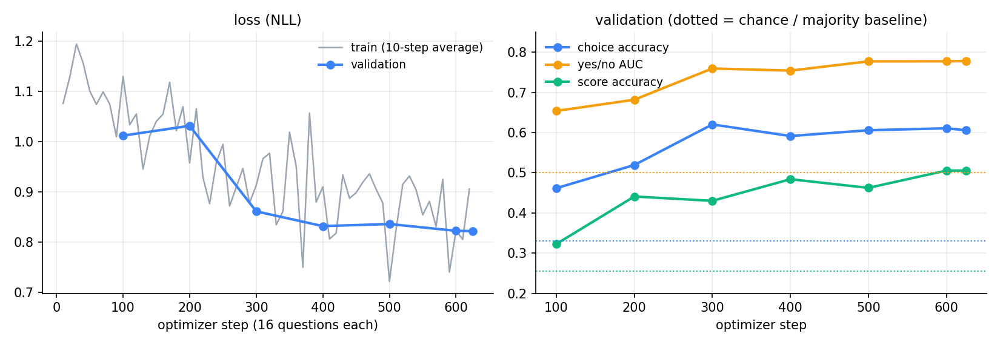

# nbev: order-invariant multiple-choice decisions with a bidirectional encoder

nbev ("new BEV") picks the best answer to a question about a conversation: route a support ticket to the right team, say yes or no, give a 1–5 score. It reads the question, the conversation and **every candidate answer in one DeBERTa-v3 pass**. It returns one **calibrated** probability per candidate, and the result does not depend on the order in which the candidates are listed.

It started from [BEV](https://github.com/avbiswas/bev-train) by Avishek Biswas, which does this with a Qwen3 decoder. nbev takes BEV's order-invariance trick to an encoder-only model, adds a calibration and evaluation pipeline, and keeps the original Qwen model as a benchmark. See [What comes from BEV, what is new](#what-comes-from-bev-what-is-new).


## The task

The dataset is [avbiswas/bev-decision-150K](https://huggingface.co/datasets/avbiswas/bev-decision-150K). Every example is a *state* (a conversation or document ending with a `Response:` to judge), an instruction, and a set of candidate answers. There are three kinds of question:

| Task | Example | What we use |
|---|---|---|
| `choice` | "Which team should handle this ticket?" → Billing / Tech support / Sales | the probability of each option |
| `noul` | "Does the response answer the question?" → Yes / No | P(yes) |
| `score` | "Rate the response from 1 to 5" | the expected score Σ i·pᵢ |

All three use the same model, so the candidates can be any text of any length and in any number. They aren't single tokens or fixed classes.

## Results

These numbers come from a 20-minute run on a MacBook (M5 Pro, MPS): 10,000 training questions, one epoch, DeBERTa-v3-base fully fine-tuned. The test questions were never seen in training, checkpoint selection or calibration.

| Test (1,000 questions) | nbev | Majority / chance baseline |
|---|---|---|
| `choice` accuracy | **0.577** | 0.33 |
| `score` accuracy (MAE of the expected score) | **0.468** (0.85) | 0.255 |
| `noul` accuracy / AUC | 0.702 / **0.767** | 0.666 ("always No") / 0.5 |
| Calibration error (ECE) choice / noul / score | **0.034 / 0.063 / 0.051** | |



- **Order invariance holds:** shuffling the candidates changes their probabilities by at most 7·10⁻⁵, which is bf16 rounding.
- **Speed:** nbev trains about 3× faster than a DeBERTa cross-encoder (1.6–2.2 s against 6.2 s per step of 16 questions). The context is encoded once per question, not once per candidate.
- **Calibration:** after temperature scaling, a predicted 70% comes true about 70% of the time. The fitted temperatures are 1.36 (choice), 1.23 (noul) and 0.90 (score).
- **Yes/no is the weak spot:** accuracy is only 3.6 points above always answering "No". The AUC of 0.77 shows the model ranks yes/no cases well, so this run is short of training rather than broken.

This is a small-budget run. A controlled comparison of the three architectures on identical data is set up in [`configs/compare/`](configs/compare/); see [Benchmarking](#benchmarking-against-bev).

## How nbev works

### 1. One packed sequence per question

```
[CLS] task hint + question + state [SEP]  [OPT] Billing [SEP]  [OPT] Tech support [SEP]  [OPT] Sales [SEP]
positions:  0 ...................... n-1    n    n+1 n+2         n    n+1  n+2    n+3      n    n+1  n+2
```

A cross-encoder builds one sequence per candidate (`[CLS] context [SEP] candidate [SEP]`), so a 4-candidate question re-encodes the same 448-token context 4 times. nbev puts the context once, followed by every candidate block. Code: [`architectures/nbev/tokenization.py`](architectures/nbev/tokenization.py).

### 2. Shared positions: order invariance

Every candidate block restarts at the same position `n`, so no candidate is "first" or "last". The rest of the encoder is symmetric: a bidirectional encoder with no positional difference between the blocks treats them as a set. Swapping two candidates swaps their output vectors and changes nothing else. A causal decoder like BEV's Qwen also needs the mask below for invariance, because a later token always sees the earlier ones. A bidirectional encoder gets invariance from the positions alone.

### 3. The attention mask: candidates never see each other

Positions alone aren't enough, for a different reason. Without a mask, tokens of different candidates sit at the same positions, and attention can't tell which candidate a token belongs to:

> "not good" + "very bad" would be the same input as "very good" + "not bad", and every `[OPT]` token would get the same vector.

I measured both effects before adding the mask. So the mask (figure above) allows:

| Query → key | Allowed? |
|---|---|
| context → context | yes: the context is encoded once, independently of the candidates |
| candidate → context | yes |
| candidate → its own tokens | yes |
| candidate → another candidate | **no** |

Each candidate is read as if it were the only one after the question. Comparing candidates is left to the decision head, which can do it without breaking invariance.

### 4. `[OPT]`: one vector per candidate, whatever its length

Each block starts with an `[OPT]` marker (DeBERTa's `[MASK]` token reused, so the vocabulary is unchanged). It attends to all of its candidate's tokens, and its output vector represents the candidate, like the `[ENT]` token in GLiNER. "Tech support" (2 tokens) and "Sales" (1 token) each get one vector without averaging or truncation. `model.pooling` can switch to `mean` (mean of the candidate's tokens) or `opt_mean` (both) for ablations.

### 5. Shared positions in DeBERTa-v3: a relative-position patch

DeBERTa-v3 has **no absolute position embeddings**. Attention only sees the distance between two tokens, through log-bucketed relative positions. So shared positions are passed as a per-question relative-position matrix `rel[b, q, k] = pos[b, q] − pos[b, k]`. The stock Hugging Face code accepts only one such matrix for the whole batch. [`architectures/nbev/network.py`](architectures/nbev/network.py) patches each attention layer to compute its position bias question by question with the library's own function. A test checks that the patched model reproduces stock DeBERTa exactly on an ordinary sequence.

### 6. Decision head

The `candidate_mlp` head in [`architectures/choice_head.py`](architectures/choice_head.py) takes the candidate vectors and runs self-attention between them **with no positional encoding**, so the candidates can be compared and invariance is kept. The same MLP then turns each candidate into a logit. A softmax over the candidates gives the probabilities. The head runs in fp32 even under bf16 autocast.

### 7. Long states keep their end

States end with the `Response:` being judged. Cutting them at 448 tokens hid the very thing to evaluate in 9% of the examples. Long states now keep their first 64 tokens plus their end, joined by `...` ([`architectures/prompts.py`](architectures/prompts.py)). This applies to all architectures.

## Calibration and evaluation

The probabilities are meant to be used directly: P(yes), or the expected score. Accuracy and AUC can't check them, because they only look at the ranking, so the pipeline treats calibration as a goal of its own:

- **Leak-free splits** ([`dataset.py`](dataset.py)): `validation` (checkpoint selection) and `calibration` (temperature fitting) are held out of the training data by **hashing the state text**, so duplicates of a state never land in two splits. `test` is the dataset's own test split.
- **Checkpoint selection by validation NLL** (`logging.select_by: loss`), not accuracy, because the probabilities are what we use.
- **Temperature scaling** ([`calibration.py`](calibration.py)): one temperature per task type, fitted on the calibration split. It's saved next to the checkpoint and applied automatically by `load_checkpoint`, `inference.py` and `answer()`. Accuracy is unchanged.
- **Metrics per task** ([`metrics.py`](metrics.py)): accuracy and NLL for everything; AUC, Brier score and ECE for P(yes); MAE of the expected score; ECE for the top choice.

## Tests

```bash
uv run python -m tests.test_nbev
```

[`tests/test_nbev.py`](tests/test_nbev.py) checks five things:
- shuffling the candidates permutes the logits and changes nothing else;
- no candidate can see another;
- batching and padding don't change the results;
- the relative-position patch reproduces stock DeBERTa;
- long states keep their end, in all three architectures.

## Quick start

```bash
uv sync                                                         # install locked dependencies
uv run python train.py configs/compare/nbev.yaml --name nbev    # ~20-30 min on an M5 Pro
uv run python calibration.py runs/nbev-<timestamp>/checkpoints/best --max_questions 1000
uv run python inference.py runs/nbev-<timestamp>/checkpoints/best --split test --max_questions 1000
```

The code picks CUDA, then Apple MPS, then CPU. The first run downloads the model and the dataset.

**Walkthrough notebook:** [`deberta_full_walkthrough.ipynb`](deberta_full_walkthrough.ipynb) runs everything end to end:
- data and the packed encoding;
- the attention mask;
- training curves and calibration (metrics before and after temperature scaling);
- test metrics and the order-invariance check;
- questions of your own through `ask(...)`.

It uses [`configs/deberta_walkthrough.yaml`](configs/deberta_walkthrough.yaml) and reuses a finished run instead of retraining.

Other entry points:
- `--resume runs/<id>/checkpoints/final` starts from saved weights;
- `full_finetune: true` trains every weight, while `lora.last_k_layers: k` freezes the backbone and adds LoRA to its last k layers;
- `data.group_by_length: true` batches questions of similar length;
- `optim.grad_accum_steps` sets gradient accumulation.

## Benchmarking against BEV

`model.architecture` selects the encoder. Data, prompts, training loop, calibration and metrics are shared, so the comparison is like for like:

| | `qwen_bev` (original BEV) | `deberta_cross` | `nbev` (this project) |
|---|---|---|---|
| Backbone | Qwen3-0.6B decoder (causal), LoRA | DeBERTa-v3 encoder, full fine-tune | DeBERTa-v3 encoder, full fine-tune |
| Sequences per question | 1 | 1 per candidate | 1 |
| Order invariance | shared positions + mask | separate sequences | shared positions (+ mask to keep candidates apart) |
| Candidate vector | last token of the candidate | `[CLS]` or mean of candidate tokens | `[OPT]` token (or mean / both) |
| Context encoded | once | once per candidate | once |
| Code | [`qwen_bev/`](architectures/qwen_bev/) | [`deberta_cross/`](architectures/deberta_cross/) | [`nbev/`](architectures/nbev/) |

[`configs/compare/`](configs/compare/) runs all of them on the same 10K questions with the same truncation, batch size, and checkpoint rule:

```bash
for c in nbev deberta_mean deberta_cls qwen_bev; do
  uv run python train.py configs/compare/$c.yaml --name cmp-$c
done
```

## What comes from BEV, what is new

| From [BEV](https://github.com/avbiswas/bev-train) (Avishek Biswas) | New in nbev |
|---|---|
| The idea of packing all candidates into one sequence with shared positions and a mask | Moving it to a **bidirectional encoder**, and the analysis of why positions give invariance but the mask is still needed |
| The Qwen3 decoder model (`qwen_bev`), kept as the benchmark | The `nbev` encoder: `[OPT]` token pooling and the DeBERTa-v3 **relative-position patch** |
| The dataset, task types and prompt format | The `deberta_cross` cross-encoder baseline and the shared `architectures/` package |
| The `bilinear_answer` decision head and the training loop | The `candidate_mlp` head |
| Data loading, logging, inference | **Calibration**: leak-free validation/calibration splits, per-task temperature scaling, ECE/Brier/AUC metrics, selection by NLL |
| | Head+tail truncation, length-grouped batching, the invariance and isolation tests, and the walkthrough notebook |

The original livestream walkthrough of BEV is in [`arch.ipynb`](arch.ipynb) ([video](https://youtube.com/live/AzxoU7kxjig)).

## Repository layout

```
architectures/
  nbev/            packed DeBERTa encoder (this project): tokenization.py, network.py
  deberta_cross/   DeBERTa cross-encoder baseline
  qwen_bev/        original BEV (Qwen3 decoder)
  choice_head.py   decision heads (candidate_mlp, bilinear_answer)
  prompts.py       prompt text and head+tail truncation
dataset.py         loading, leak-free splits, length-grouped batching
train.py           training loop, gradient accumulation, checkpoint selection
calibration.py     per-task temperature scaling
metrics.py         per-task metrics (NLL, AUC, Brier, ECE, MAE)
inference.py       evaluation and answer()
configs/           training configs (compare/ = like-for-like benchmark)
tests/             invariance, isolation and patch tests
scripts/           README figures
```
