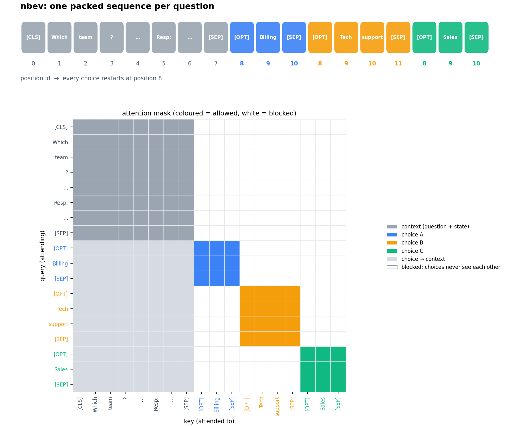
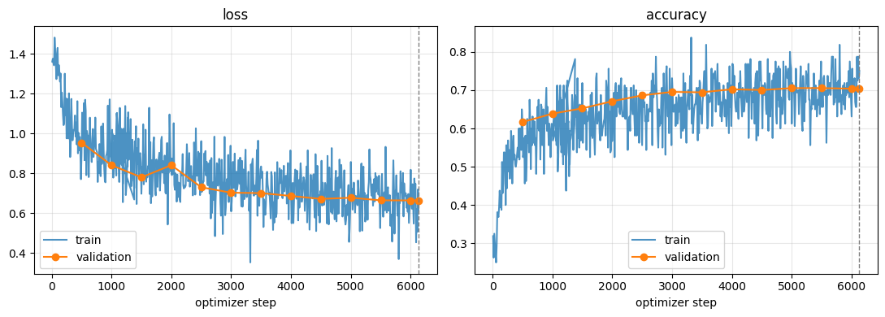
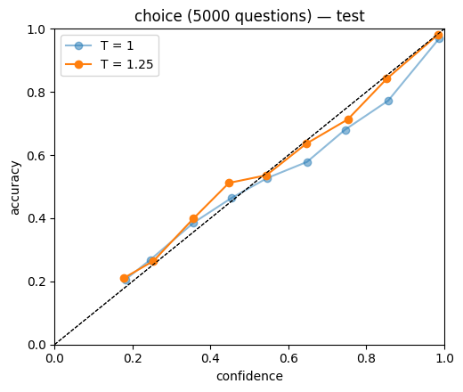

# nbev: order-invariant multiple-choice decisions with a bidirectional encoder

nbev ("new BEV") picks the best answer to a question about a conversation: route a support ticket to the right team, say yes or no, give a 1–5 score. It reads the question, the conversation and **every candidate answer in one DeBERTa-v3 pass**. It returns one **calibrated** probability per candidate, and the result does not depend on the order in which the candidates are listed.

It started from [BEV](https://github.com/avbiswas/bev-train) by Avishek Biswas, which does this with a Qwen3 decoder. nbev takes BEV's order-invariance trick to an encoder-only model, adds a calibration and evaluation pipeline, and keeps the original Qwen model as a benchmark. See [What comes from BEV, what is new](#what-comes-from-bev-what-is-new).

**Start here:** [`choice_walkthrough.ipynb`](choice_walkthrough.ipynb) walks through nbev trained on all ~98K multiple-choice questions: data, model, training, calibration, test results, example predictions, and questions of your own. See [Quick start](#quick-start).



## The task

The dataset is [avbiswas/bev-decision-150K](https://huggingface.co/datasets/avbiswas/bev-decision-150K). Every example is a *state* (a conversation or document ending with a `Response:` to judge), an instruction, and a set of candidate answers. There are three kinds of question:

| Task | Example | What we use |
|---|---|---|
| `choice` | "Which team should handle this ticket?" → Billing / Tech support / Sales | the probability of each option |
| `noul` | "Does the response answer the question?" → Yes / No | P(yes) |
| `score` | "Rate the response from 1 to 5" | the expected score Σ i·pᵢ |

All three use the same model, so the candidates can be any text of any length and in any number. They aren't single tokens or fixed classes.

The results below are on `choice` questions. The code handles all three types, but so far only the choice model has been trained long enough to report.

## Results: multiple choice

nbev (DeBERTa-v3-base, fully fine-tuned) was trained on all 98,085 `choice` training questions for one epoch: 6,130 optimizer steps of 16 questions, 2.1 h on a MacBook (M5 Pro, MPS), with [`configs/choice_full.yaml`](configs/choice_full.yaml). The test questions were never seen in training, checkpoint selection or calibration.

| Test (5,000 choice questions, 2 to 10 options) | nbev | Chance |
|---|---|---|
| Accuracy | **0.708** (± 0.013 at 95%) | 0.26 |
| NLL | 0.672 | |
| Calibration error (ECE), before → after temperature scaling | 0.028 → **0.018** | |



- **Training:** validation NLL falls at almost every check, and accuracy levels off around 0.70 from step ~4,000 as the cosine schedule takes the learning rate to 0. The best checkpoint (lowest validation NLL) is the last one. A pilot on 10K choice questions ([`configs/choice_walkthrough.yaml`](configs/choice_walkthrough.yaml)) reached 0.62 on the same test questions, so 10× more data gave about +9 points.
- **Calibration:** one temperature, T = 1.25, fitted on 1,943 calibration questions. T > 1 means the raw model was slightly over-confident. After scaling, an answer given with 70% confidence is right about 70% of the time. Accuracy is unchanged.
- **Speed:** 28 ms per question end to end (tokenization, one forward pass, softmax), about 36 questions per second on MPS. The context is encoded once, so a question takes 12 ms with 2 options and 86 ms with 32.
- **Order invariance** is exact up to floating-point rounding, and [`tests/test_nbev.py`](tests/test_nbev.py) checks it.



### By domain

The kind of question matters much more than the number of options:

| Domain | Test questions | Accuracy | Chance |
|---|---|---|---|
| Spatial and logical reasoning | 1,592 | 0.54 | 0.23 |
| Support and intent routing | 762 | 0.97 | 0.25 |
| Retail, product, and shopping | 612 | 0.44 | 0.21 |
| Tool and workflow decisions | 582 | 0.99 | 0.30 |
| Software engineering and code | 537 | 0.69 | 0.25 |
| Sentiment, emotion, and moderation | 295 | 0.85 | 0.25 |
| Response preference and quality | 184 | 0.64 | 0.50 |
| Scientific and paper understanding | 122 | 0.89 | 0.33 |
| Contract evidence | 95 | 0.63 | 0.33 |
| Browser interaction | 83 | 0.87 | 0.20 |

Three smaller domains (under 70 questions each) are in the notebook.

- **Nearly solved** when the answer is a match or a classification: tool choice, intent routing, paper understanding, browser actions, emotions. Most of the confident mistakes there are ambiguous labels, such as `datetime_query` vs `datetime_convert` for a time-zone question.
- **Hard** when the answer must be computed from the state: spatial and logical puzzles (a third of the test) and retail invoices ("largest quantity × unit price", "cheapest per unit"). One forward pass of a 184M-parameter encoder handles arithmetic and multi-step spatial reasoning poorly; a larger backbone would most likely help there first.

**Not reported yet.** Yes/no (`noul`) and score questions, the DeBERTa cross-encoder baseline and the original BEV model (`qwen_bev`) all run with this code, but none of them has been trained at a comparable scale yet, so their numbers are left out. See [Benchmarking against BEV](#benchmarking-against-bev).

## Quick start

```bash
uv sync                                                                                  # install locked dependencies
caffeinate -i uv run python train.py configs/choice_full.yaml --name nbev-choice-full   # ~2 h on an M5 Pro
```

Then open [`choice_walkthrough.ipynb`](choice_walkthrough.ipynb). It loads the latest `runs/nbev-choice-full-*` run (it never trains), fits the temperature on the calibration split, measures the test split once and saves `test_metrics.json` in the run folder. Model outputs are cached next to the checkpoint, so the first run takes ~10 min and later ones ~1 min.

- `caffeinate -i` keeps a Mac awake while the run lasts; drop it on other systems. The code picks CUDA, then Apple MPS, then CPU. The first run downloads the model and the dataset.
- A run that stops continues where it left off: `uv run python train.py configs/choice_full.yaml --continue_run runs/nbev-choice-full-<timestamp>`. `checkpoints/latest` (weights, optimizer, LR schedule, data position) is saved every 500 steps.
- For a 25–30 min run on 10K questions, train [`configs/choice_walkthrough.yaml`](configs/choice_walkthrough.yaml) and set `CONFIG_PATH` and `RUN_NAME` in the notebook's first cell.

The same steps without the notebook:

```bash
uv run python calibration.py runs/nbev-choice-full-<timestamp>/checkpoints/best
uv run python inference.py runs/nbev-choice-full-<timestamp>/checkpoints/best --split test --max_questions 5000
```

### Notebooks

| Notebook | What it covers |
|---|---|
| [`choice_walkthrough.ipynb`](choice_walkthrough.ipynb) (**entry point**) | The trained choice model: data and splits, the packed input, training curves, parameters layer by layer, calibration, test results by domain and by number of options, inference speed, predictions and the most confident mistakes, and `ask(...)` for your own questions |
| [`deberta_full_walkthrough.ipynb`](deberta_full_walkthrough.ipynb) | The architecture step by step on all three question types: the packed encoding, what the model reads, the attention mask. Its training run ([`configs/deberta_walkthrough.yaml`](configs/deberta_walkthrough.yaml)) is a short demo, not a result |
| [`arch.ipynb`](arch.ipynb) | The original BEV livestream walkthrough ([video](https://youtube.com/live/AzxoU7kxjig)) |

### Training options

- `data.task_types: [choice]` keeps one question type (null or absent keeps all three); the splits stay leak-free;
- `--resume runs/<id>/checkpoints/final` starts from saved weights, with a fresh optimizer and schedule;
- `full_finetune: true` trains every weight, while `lora.last_k_layers: k` freezes the backbone and adds LoRA to its last k layers;
- `data.group_by_length: true` batches questions of similar length;
- `optim.grad_accum_steps` sets gradient accumulation.

## How nbev works

### 1. One packed sequence per question

```
[CLS] task hint + question + state [SEP]  [OPT] Billing [SEP]  [OPT] Tech support [SEP]  [OPT] Sales [SEP]
positions:  0 ...................... n-1    n    n+1 n+2         n    n+1  n+2    n+3      n    n+1  n+2
```

A cross-encoder builds one sequence per candidate (`[CLS] context [SEP] candidate [SEP]`), so a 4-candidate question re-encodes the same 448-token context 4 times. nbev puts the context once, followed by every candidate block. Code: [`architectures/nbev/tokenization.py`](architectures/nbev/tokenization.py).

### 2. Shared positions: order invariance

Every candidate block restarts at the same position `n`, so no candidate is "first" or "last". The rest of the encoder is symmetric: a bidirectional encoder with no positional difference between the blocks treats them as a set. Swapping two candidates swaps their output vectors and changes nothing else. A causal decoder like BEV's Qwen also needs the mask below for invariance, because a later token always sees the earlier ones. A bidirectional encoder gets invariance from the positions alone.

### 3. The attention mask: candidates never see each other

Positions alone aren't enough, for a different reason. Without a mask, tokens of different candidates sit at the same positions, and attention can't tell which candidate a token belongs to:

> "not good" + "very bad" would be the same input as "very good" + "not bad", and every `[OPT]` token would get the same vector.

I measured both effects before adding the mask. So the mask (figure above) allows:

| Query → key | Allowed? |
|---|---|
| context → context | yes: the context is encoded once, independently of the candidates |
| candidate → context | yes |
| candidate → its own tokens | yes |
| candidate → another candidate | **no** |

Each candidate is read as if it were the only one after the question. Comparing candidates is left to the decision head, which can do it without breaking invariance.

### 4. `[OPT]`: one vector per candidate, whatever its length

Each block starts with an `[OPT]` marker (DeBERTa's `[MASK]` token reused, so the vocabulary is unchanged). It attends to all of its candidate's tokens, and its output vector represents the candidate, like the `[ENT]` token in GLiNER. "Tech support" (2 tokens) and "Sales" (1 token) each get one vector without averaging or truncation. `model.pooling` can switch to `mean` (mean of the candidate's tokens) or `opt_mean` (both) for ablations.

### 5. Shared positions in DeBERTa-v3: a relative-position patch

DeBERTa-v3 has **no absolute position embeddings**. Attention only sees the distance between two tokens, through log-bucketed relative positions. So shared positions are passed as a per-question relative-position matrix `rel[b, q, k] = pos[b, q] − pos[b, k]`. The stock Hugging Face code accepts only one such matrix for the whole batch. [`architectures/nbev/network.py`](architectures/nbev/network.py) patches each attention layer to compute its position bias question by question with the library's own function. A test checks that the patched model reproduces stock DeBERTa exactly on an ordinary sequence.

### 6. Decision head

The `candidate_mlp` head in [`architectures/choice_head.py`](architectures/choice_head.py) takes the candidate vectors and runs self-attention between them **with no positional encoding**, so the candidates can be compared and invariance is kept. The same MLP then turns each candidate into a logit. A softmax over the candidates gives the probabilities. The head runs in fp32 even under bf16 autocast.

### 7. Long states keep their end

States end with the `Response:` being judged. Cutting them at 448 tokens hid the very thing to evaluate in 9% of the examples. Long states now keep their first 64 tokens plus their end, joined by `...` ([`architectures/prompts.py`](architectures/prompts.py)). This applies to all architectures.

## Calibration and evaluation

The probabilities are meant to be used directly: P(yes), or the expected score. Accuracy and AUC can't check them, because they only look at the ranking, so the pipeline treats calibration as a goal of its own:

- **Leak-free splits** ([`dataset.py`](dataset.py)): `validation` (checkpoint selection) and `calibration` (temperature fitting) are held out of the training data by **hashing the state text**, so duplicates of a state never land in two splits. `test` is the dataset's own test split.
- **Checkpoint selection by validation NLL** (`logging.select_by: loss`), not accuracy, because the probabilities are what we use.
- **Temperature scaling** ([`calibration.py`](calibration.py)): one temperature per task type, fitted on the calibration split. It's saved next to the checkpoint and applied automatically by `load_checkpoint`, `inference.py` and `answer()`. Accuracy is unchanged.
- **Metrics per task** ([`metrics.py`](metrics.py)): accuracy and NLL for everything; AUC, Brier score and ECE for P(yes); MAE of the expected score; ECE for the top choice.

## Tests

```bash
uv run python -m tests.test_nbev
```

[`tests/test_nbev.py`](tests/test_nbev.py) checks five things:
- shuffling the candidates permutes the logits and changes nothing else;
- no candidate can see another;
- batching and padding don't change the results;
- the relative-position patch reproduces stock DeBERTa;
- long states keep their end, in all three architectures.

## Benchmarking against BEV

`model.architecture` selects the encoder. Data, prompts, training loop, calibration and metrics are shared, so the comparison is like for like:

| | `qwen_bev` (original BEV) | `deberta_cross` | `nbev` (this project) |
|---|---|---|---|
| Backbone | Qwen3-0.6B decoder (causal), LoRA | DeBERTa-v3 encoder, full fine-tune | DeBERTa-v3 encoder, full fine-tune |
| Sequences per question | 1 | 1 per candidate | 1 |
| Order invariance | shared positions + mask | separate sequences | shared positions (+ mask to keep candidates apart) |
| Candidate vector | last token of the candidate | `[CLS]` or mean of candidate tokens | `[OPT]` token (or mean / both) |
| Context encoded | once | once per candidate | once |
| Code | [`qwen_bev/`](architectures/qwen_bev/) | [`deberta_cross/`](architectures/deberta_cross/) | [`nbev/`](architectures/nbev/) |

[`configs/compare/`](configs/compare/) runs all of them on the same 10K questions with the same truncation, batch size, and checkpoint rule. These runs are set up but haven't been trained at the scale of the choice model yet, so no comparison numbers are reported.

```bash
for c in nbev deberta_mean deberta_cls qwen_bev; do
  uv run python train.py configs/compare/$c.yaml --name cmp-$c
done
```

## What comes from BEV, what is new

| From [BEV](https://github.com/avbiswas/bev-train) (Avishek Biswas) | New in nbev |
|---|---|
| The idea of packing all candidates into one sequence with shared positions and a mask | Moving it to a **bidirectional encoder**, and the analysis of why positions give invariance but the mask is still needed |
| The Qwen3 decoder model (`qwen_bev`), kept as the benchmark | The `nbev` encoder: `[OPT]` token pooling and the DeBERTa-v3 **relative-position patch** |
| The dataset, task types and prompt format | The `deberta_cross` cross-encoder baseline and the shared `architectures/` package |
| The `bilinear_answer` decision head and the training loop | The `candidate_mlp` head |
| Data loading, logging, inference | **Calibration**: leak-free validation/calibration splits, per-task temperature scaling, ECE/Brier/AUC metrics, selection by NLL. BEV picked its best checkpoint by accuracy on the test split, which inflates the test number; here test is never seen before the end |
| | Head+tail truncation, length-grouped batching, single-task training (`data.task_types`), resumable runs (`--continue_run`), the invariance and isolation tests, and the walkthrough notebooks |

## Repository layout

```
choice_walkthrough.ipynb         entry point: the trained multiple-choice model
deberta_full_walkthrough.ipynb   the architecture step by step, all three task types
architectures/
  nbev/            packed DeBERTa encoder (this project): tokenization.py, network.py
  deberta_cross/   DeBERTa cross-encoder baseline
  qwen_bev/        original BEV (Qwen3 decoder)
  choice_head.py   decision heads (candidate_mlp, bilinear_answer)
  prompts.py       prompt text and head+tail truncation
dataset.py         loading, leak-free splits, task-type filter, length-grouped batching
train.py           training loop, gradient accumulation, checkpoint selection, --continue_run
calibration.py     per-task temperature scaling
metrics.py         per-task metrics (NLL, AUC, Brier, ECE, MAE)
inference.py       evaluation and answer()
notebook_utils.py  notebook helpers: plots, cached evaluation, predictions, ask()
configs/           training configs (choice_full = the reported run, compare/ = like-for-like benchmark)
tests/             invariance, isolation and patch tests
scripts/           README figures
```
